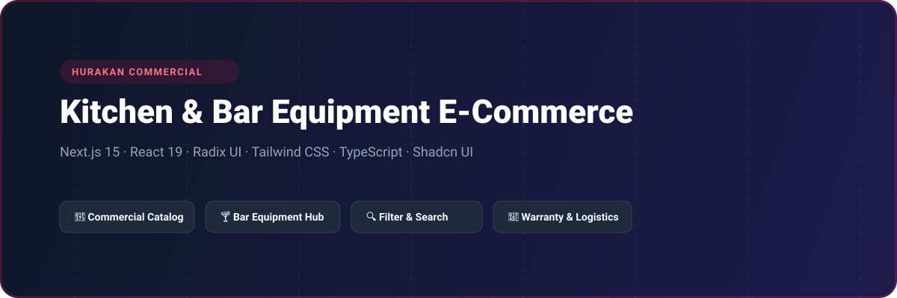
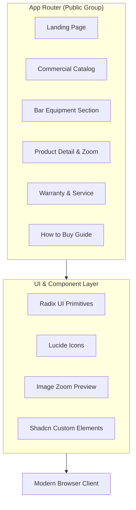

# Hurakan Commercial Kitchen & Bar Equipment Web Portal

<p align="center">
  
</p>

<p align="center">
  <a href="https://nextjs.org"></a>
  <a href="https://react.dev"></a>
  <a href="https://www.typescriptlang.org"></a>
  <a href="https://tailwindcss.com"></a>
  <a href="https://radix-ui.com"></a>
  <a href="LICENSE"></a>
</p>

---

## 📖 Overview

**Hurakan Frontend (`onine8seven_frontend`)** is a commercial kitchen, restaurant, and bar equipment catalog and procurement web platform. Built with Next.js 15 App Router and React 19, the application features catalog browsing, technical specifications inspection, interactive media zoom, warranty validation, and inquiry management for hospitality businesses.

---

## ⚡ Key Features

- **🍳 Industrial Equipment Catalog:** Categorized directory for professional cooking, cooling, food processing, and bar preparation appliances.
- **🔍 Technical Filter & Search:** Parametric query filters for voltage, dimensions, power rating, and capacity specifications.
- **🔍 High-Resolution Product Inspection:** Integrated `react-medium-image-zoom` for close-up examination of heavy culinary equipment.
- **📜 Warranty & Logistics Workflows:** Detailed procurement guide, warranty validation requests, and distributor location maps.
- **📱 Fully Responsive Hospitality UI:** Designed with Radix UI and Tailwind CSS for mobile, tablet, and commercial point-of-sale displays.

---

## 🏗️ System Architecture



---

## 🗂️ Project Structure

```
onine8seven_frontend/
├── assets/
│   └── banner.svg         # Architectural repository banner
├── src/
│   ├── app/
│   │   ├── (public)/      # Catalog, Bar Equipment, Warranty, How to Buy
│   │   ├── globals.css    # Tailwind CSS design tokens
│   │   ├── layout.tsx     # Root site layout & header/footer
│   │   └── page.tsx       # Landing page
│   ├── components/        # Reusable UI components & dialogs
│   ├── assets/            # Static product graphics
│   └── lib/               # Utility functions
├── package.json
└── tsconfig.json
```

---

## 🛠️ Tech Stack

| Technology | Purpose |
| :--- | :--- |
| **Next.js 15** | Server and client rendering framework with App Router |
| **React 19** | Modern UI library runtime |
| **TypeScript 5** | Strict type definitions |
| **Tailwind CSS v4** | Rapid utility-first component styling |
| **Radix UI** | Accessible headless UI components |
| **React Medium Image Zoom**| Technical product blueprint and image zoom |
| **Lucide React** | Industrial UI iconography |

---

## 🚀 Getting Started

### Prerequisites

- Node.js >= 20.0.0
- npm, pnpm, or bun

### Installation

1. Clone the repository:
   ```bash
   git clone https://github.com/shahjalal-labs/onine8seven_frontend.git
   cd onine8seven_frontend
   ```

2. Install dependencies:
   ```bash
   npm install
   ```

3. Configure environment variables:
   ```bash
   cp .env.example .env.local
   ```

4. Start development server:
   ```bash
   npm run dev
   ```
   Open [http://localhost:3000](http://localhost:3000) to view the portal.

---

## 📄 License

This project is licensed under the [ISC License](LICENSE).
